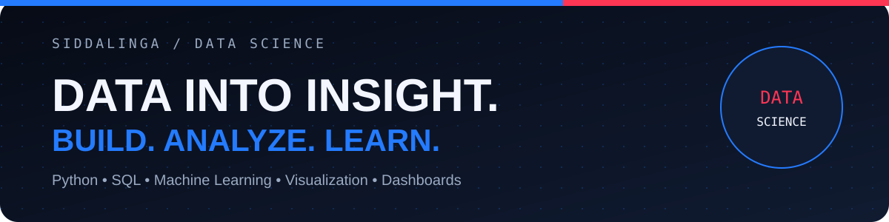

# SIDDALINGA

### Data Science & Data Analytics Student

**Turning data into clear stories, useful insights, and practical products.**

📚 Coding and reading tech articles

---

## Hello, I’m Siddalinga 👋

I am a data science student who enjoys exploring data, building visual explanations, and creating practical technology solutions. My work combines programming, analytics, dashboards, and machine learning to turn real-world questions into understandable results.

## What I work with

| Languages | Data & Analytics | Visualization |
| --- | --- | --- |
| Python · R · PHP · SQL | NumPy · Pandas · Data Analysis | Matplotlib · Tableau · Power BI |

## Featured projects

### 🚌 Where Is My Bus?

An IoT-driven transit tracking solution designed to make public transportation more reliable for commuters in Bidar. ESP32 and Raspberry Pi hardware work with Neo-6M GPS and SIM7600 cellular modules to capture and broadcast live vehicle locations so passengers can track buses in real time.

### 📈 AI Stock Market Price Prediction

An AI-driven web application that studies historical NIFTY 50 data from `yfinance` and uses Long Short-Term Memory neural networks to forecast future price movement. The dashboard combines historical charts, model predictions, backtesting, and an interactive user experience.

## Currently learning

- Applied machine learning and time-series forecasting
- Reliable data pipelines and model evaluation
- Building clear dashboards for analytical decisions

## Let’s connect

I’m interested in data science, analytics, visualization, machine learning, and projects that solve practical problems.

[LinkedIn](https://www.linkedin.com/in/siddaling-sh-99b006c/) · [Portfolio](https://protofolio-three-sable.vercel.app/) · [Email me](mailto:siddalingsh6@gmail.com)

Built with curiosity and a love for technology.

